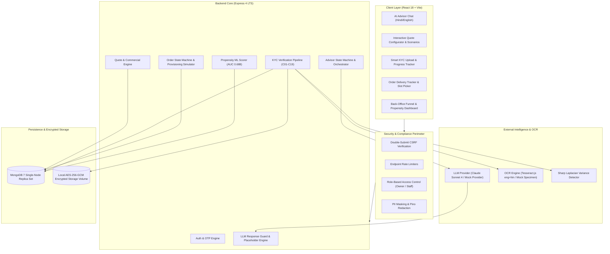
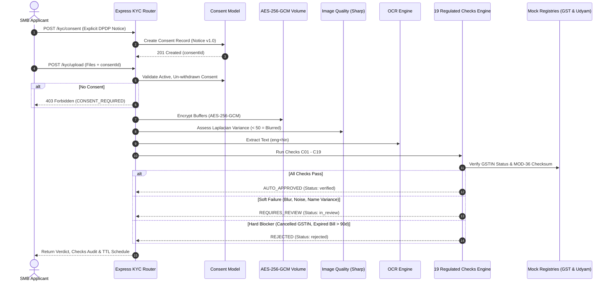
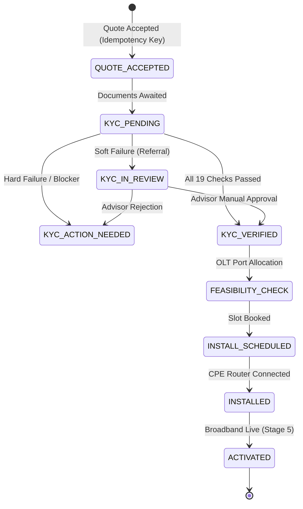

# System Architecture & Technical Specifications

**Product:** Udyam One — Regulated MERN SMB Onboarding & Delivery Platform  
**Hackathon:** Airtel SYNC 2026, Digital Track A (Project Udyam Digital)  
**Engineering Principle:** Correctness, honesty, and clarity beat feature count.

---

## 1. High-Level Architecture Overview

Udyam One is engineered as a mobile-first, enterprise-grade distributed web application with strict separation between deterministic business rules and non-deterministic natural language generation.



---

## 2. Core Architectural Pillars

### 2.1. Strict Separation: Rules Engine owns Facts; LLM owns Language
Under **Non-negotiable Rule 1 & Rule 2**, the Large Language Model is strictly forbidden from computing prices, totals, taxes, contract terms, or product eligibility:
1. **Determinism:** All pricing, bundle dependencies (`requires_one_of`), GSTIN mandates (`requires_gstin`), and contract commitments are evaluated exclusively by the deterministic server rules engine (`server/src/rules/engine.js`).
2. **Placeholder Substitution:** The LLM receives structured profile facts and emits response templates containing bracketed placeholders:
   ```text
   {{tierLabel}} plan aapke business ke liye best hai: {{quote.monthlyTotal}} / mahina.
   ```
3. **Response Guard (`server/src/advisor/guard.js`):** Every LLM output passes through an adversarial regex response guard prior to client transmission:
   - Blocks raw currency amounts (`₹`, `Rs`, `INR`, `1,299`).
   - Blocks raw product codes (`P01` to `P25`).
   - Blocks raw percentage numbers (`18%`, `20%`).
   - Hydrates validated numbers from the server quote result. If any unauthorized number is detected, the message is quarantined and safely regenerated from deterministic fallback copy.

### 2.2. Zero Hardcoding: Immutable Catalogue Seed
All commercial values are loaded from `data/product_catalogue.csv` directly into MongoDB on initialization:
- 25 verified enterprise products.
- Minimum/maximum prices, one-time installation setup fees, minimum contract tenures.
- Rule 11 Price Immutability: Once a customer accepts a quote (`POST /quotes/:id/accept`), the price hash is permanently locked. Order creation re-evaluates the rules engine and strictly rejects with `409 PRICE_DRIFT` if catalogue pricing changes.

---

## 3. Smart KYC Pipeline Architecture (Checks C01 to C19)

The KYC pipeline processes document specimens through 19 regulated verification checks:



### Regulated Check Matrix:
- **C01 (Consent Gate):** Active non-withdrawn consent record verified.
- **C02 (Completeness):** GST certificate, Signatory ID, and Address proof present (Udyam optional).
- **C03 & C04 (Format & Size):** Magic bytes verified (JPEG/PNG/PDF), payload <= 5 MB.
- **C05 (Blur Detection):** Sharp Laplacian discrete convolution variance >= 50.
- **C06 (Classification):** Template classification matches document specimen layout.
- **C07 (Entity & Signatory Match):** Jaro-Winkler match (>= 0.85) with LLP entity authorization logic.
- **C08 (Address Freshness):** Bill date within 90 days of reference date (`2026-07-15`).
- **C09 & C10 (GSTIN Validation):** MOD-36 checksum validated; registry status verified as `Active`. Non-active (`Cancelled`, `Suspended`) triggers immediate hard failure.
- **C11 & C12 (Udyam Validation):** Format regex verified; cross-referenced with enterprise registry.
- **C13 & C14 (Consistency):** Constitution and 2-digit state prefix match address proof.
- **C15 & C16 (Integrity):** Synthetic ID structure validated; noise/corrupted tokens flagged.
- **C17 (Decision Engine):** Deterministic routing (Hard fail -> Rejected, Soft fail -> Review queue, Clean -> Verified).
- **C18 (Encrypted Storage):** Files saved with random 12-byte IV and 16-byte GCM auth tag.
- **C19 (Retention Schedule):** Rejected files purged at 30 days; verified customer records retained for 180 days.

---

## 4. Order Lifecycle & Provisioning Simulator

Orders follow a deterministic, auditable state machine governed by `ORDER_TRANSITIONS`:



### Proactive Non-Voice Support:
Instead of requiring customers to dial call-center queues, any order can raise a `HelpRequest` directly from the tracker (`POST /orders/:id/help`). Context snapshots (order status, technician notes, slot preferences) are attached and routed to the assigned dispatch engineer.

---

## 5. Machine Learning Propensity Engine

To solve the historical leak where **65% of leads drop before needs assessment**, Udyam One incorporates an L2-regularized Logistic Regression model trained on `data/smb_leads.csv` (5,000 observations):
- **Model Metric:** ROC AUC `0.6879` (honest benchmark, zero fabricated claims).
- **Top Positive Drivers:** GSTIN present (+0.169), Professional offices (+0.181), Referral lead (+0.126), Higher monthly telecom spend (+0.150).
- **Negative Drivers:** Cold web form (-0.159), Unassigned field visits (-0.057).
- **Explainable Output:** Every scored lead outputs the top 3 contributing factors for transparent advisor triage.
