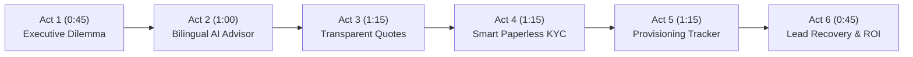

# Udyam One: Master Live Demonstration Guide (5–7 Minutes)
**Airtel Sync 2026 Hackathon · Problem Statement Track A: Digital Onboarding & Enterprise Connectivity**

---

## 1. Demonstration Overview & Objectives

This guide is the authoritative script for conducting a 5–7 minute live evaluation for the Airtel SYNC 2026 Hackathon jury. Every action in this sequence runs live on the local deployment, exercising authenticated MongoDB persistence, the deterministic rules engine, the AI advisor response guard, AES-256-GCM encrypted document storage, and order state machines.

### Demonstration Personas & Demo Accounts

| Persona | Method / Credentials | Role & Purpose |
|---|---|---|
| **SMB Business Owner** | Phone: Any 10-digit number (e.g. `9876543210`) Simulated OTP: Dev Outbox (`http://localhost:3001/api/v1/dev/outbox`) or console | Demonstrates self-serve onboarding, AI discovery, bilingual quotes, Smart KYC, checkout, and live order tracking. |
| **Airtel Telecom Advisor** | Email: `advisor@airtel.com` Password: `DemoPassword123!` | Demonstrates back-office lead recovery, unclosed leads queue with ML Propensity Scores, and notes persistence. |
| **Field Technician Partner** | Email: `partner@airtel.com` Password: `DemoPassword123!` | Demonstrates field task dispatch, optical power level calibration ($-19.4\text{ dBm}$), and activation completion. |
| **System Administrator** | Email: `admin@airtel.com` Password: `DemoPassword123!` | Demonstrates full governance, 4-eye KYC review queue, audit logs, and security controls. |

---

## 2. Representative Customer Segment Profiles

To showcase the depth of the rules engine across different MSME verticals, four verified customer profiles are available:

### Profile A: Professional Office (Primary Demo Specimen)
- **Business Type:** CA / Law Firm / Healthcare Clinic
- **Segment:** `prof`
- **Location:** Delhi / Bengaluru (Tier 1)
- **Staff / Sites:** 8 Employees, 1 Site, Active GSTIN
- **Recommended Tiers:**
  - *Starter:* ₹1,999/mo (100 Mbps Fibre + 1 Static IP)
  - *Standard:* ₹3,290/mo (300 Mbps Fibre + Corporate Email + Static IP)
  - *Resilient:* ₹3,789/mo (300 Mbps Fibre + Corporate Email + 4G Mobile Failover + Cloud Backup)

### Profile B: Micro Retail & Services
- **Business Type:** Kirana Store / Pharmacy / Retail Shop
- **Segment:** `micro`
- **Location:** Jaipur / Indore (Tier 2)
- **Staff / Sites:** 2 Employees, 1 Site, No GSTIN
- **Recommended Tiers:**
  - *Starter:* ₹1,598/mo (100 Mbps AirFiber + Cloud POS)
  - *Standard:* ₹1,997/mo (100 Mbps AirFiber + Cloud POS + Guest Wi-Fi)
  - *Resilient:* ₹2,496/mo (100 Mbps AirFiber + Cloud POS + 4G Failover)

### Profile C: Multi-Site Business
- **Business Type:** Restaurant Chain / Retail Franchise / Diagnostic Labs
- **Segment:** `multi`
- **Location:** Mumbai / Hyderabad (Tier 1)
- **Staff / Sites:** 35 Employees, 3 Sites, 6 CCTV Cameras
- **Recommended Tiers:**
  - *Starter:* ₹5,994/mo (300 Mbps per site + Centralized Routing)
  - *Standard:* ₹5,994/mo (300 Mbps per site + Cloud CCTV + Static IP)
  - *Resilient:* ₹7,188/mo (1 Gbps per site + 4G Failover + Centralized CCTV)

### Profile D: Small Manufacturer
- **Business Type:** Auto Parts Machining / Textile Workshop
- **Segment:** `mfg`
- **Location:** Pune / Surat (Tier 2)
- **Staff / Sites:** 25 Employees, 1 Industrial Facility, Dedicated Leased Line
- **Recommended Tiers:**
  - *Starter:* ₹1,499/mo (100 Mbps + Endpoint Antivirus)
  - *Standard:* ₹1,699/mo (300 Mbps + Industrial IoT Telemetry)
  - *Resilient:* ₹2,198/mo (Dedicated Leased Line + Perimeter Firewall)

---

## 3. Step-by-Step 6-Act Clickable Walkthrough Script

### Act 1: The Executive Challenge & Funnel Reality Check (45 Seconds)
- **Page to Open:** `http://localhost:5173/backoffice` (Log in with `admin@airtel.com` / `DemoPassword123!`).
- **Exact Action:** Show the top **Executive Funnel Metrics** header and the four drop-off leak cards.
- **Expected Visible Result:** 
  - 5,000 Total Inbound Leads.
  - 368 Activated Customers (exact **7.36% Baseline Conversion**).
  - 4 Structural Leaks highlighted: 3,026 Pre-Assessment (65.3%), 1,113 Quote Drops, 273 Paperwork Failures, 220 Install Delays.
- **Key Sentence to Speak to Judges:**
  > *"Good morning, leaders. In Airtel's historical baseline cohort of 5,000 SMB leads, over 92% abandon before activation—driving blended CAC to ₹15,053. Notice that 65% of all losses occur right at the start due to technical confusion and appointment friction. Udyam One was engineered to systematically eliminate each of these four structural leaks."*
- **Failure & Recovery:** If logged out, click **"Staff Login"**, enter `admin@airtel.com` / `DemoPassword123!`.

---

### Act 2: Empathetic AI Discovery in English & Hindi (60 Seconds)
- **Page to Open:** Click **"Advisor"** in the top navigation or navigate to `http://localhost:5173/advisor`.
- **Exact Action 1:** Click the **"हिंदी"** toggle pill at the top right of the chat window. Show that all prompts switch to natural Hindi.
- **Exact Action 2:** Enter the prompt (in English or Hindi):
  `"We run a dental clinic in Jaipur with 8 employees. We need fast connectivity, guest Wi-Fi, and 1 static IP for our cloud records."`
- **Expected Visible Result:** The AI Advisor extracts the profile attributes (Jaipur, Tier 2, 8 staff, static IP, guest Wi-Fi) and recommends the **Standard Enterprise Bundle**.
- **Key Sentence to Speak to Judges:**
  > *"Instead of waiting days for a sales visit, the SMB owner has an immediate conversation in natural Hindi or English. Notice our Response Guard: the LLM is strictly firewalled from calculating prices or inventing discounts—every recommendation is bound to our verified catalogue rules."*
- **Failure & Recovery:** If offline or delayed, click any of the 3 quick-start chips (e.g. *"Dental Clinic"* or *"Kirana Store"*) to auto-populate the conversation.

---

### Act 3: Transparent Quotes & Business Continuity Preview (75 Seconds)
- **Page to Open:** Click **"View Recommended Quotes"** or open `http://localhost:5173/quotes`.
- **Exact Action 1:** Compare the three plan cards (**Starter**, **Standard**, and **Resilient**). Toggle add-ons (e.g. Cloud Backup or Static IP) and observe the monthly total recomputing live.
- **Exact Action 2:** Scroll down to **"Business Continuity & Scenario Preview"**:
  - Click **"20% Budget Cut"** — point to the dynamic breakdown showing how pruning optional Cloud Backup lowers monthly spend by ₹998/mo while keeping primary connectivity intact.
- **Exact Action 3:** Click **"Accept Quote & Lock Price"**.
- **Expected Visible Result:** Success modal confirms acceptance. Quote status updates to `🔒 Pricing Locked (Valid for 7 days)`. An attempt to switch tiers prompts confirmation for a formal revision rather than silently overwriting the locked contract.
- **Key Sentence to Speak to Judges:**
  > *"Leak 2 occurs because telecom pricing is opaque and full of hidden installation surprises. Udyam One provides a single transparent monthly total with interactive scenario testing. When the customer accepts, the pricing is cryptographically locked for 7 days."*

---

### Act 4: Regulated Smart KYC & DPDP Compliance (75 Seconds)
- **Page to Open:** Click **"Proceed to KYC"** or open `http://localhost:5173/kyc`.
- **Exact Action 1:** Review the unbundled itemized DPDP Act 2023 consent notice. Click **"Grant Consent"**.
- **Exact Action 2:** Under Specimen Selection, choose **"K03 (Clean Specimen)"** and click **"Verify Documents Instantly"**.
- **Expected Visible Result:** Instant 2-second automated verification:
  - Verdict: `AUTO_APPROVED` (Status: `verified`).
  - 19 canonical checks evaluated (C01–C19), including MOD-36 GSTIN checksum, Laplacian image blur variance, and expiry dates.
  - Document encrypted at rest with AES-256-GCM.
- **Exact Action 3 (Optional Exception Showcase):** Point out specimen **K04 (Blurred GST)**: shows how degraded files safely route to the 4-eye human review queue (`/backoffice/kyc-queue`) rather than falsely approving invalid documents.
- **Key Sentence to Speak to Judges:**
  > *"Paperwork drag historically caused 273 drop-outs. Under India's DPDP Act 2023, consent must be unbundled, explicit, and revocable. Our pipeline runs 19 canonical compliance checks, verifies image blur variance via Sharp, and encrypts documents with AES-256-GCM. Clean applications auto-approve; ambiguous ones route safely to our staff review queue."*

---

### Act 5: Checkout & Optical Provisioning Tracker (75 Seconds)
- **Page to Open:** Proceed through Checkout and navigate to `http://localhost:5173/tracker`.
- **Exact Action 1:** Select a 2-hour technician slot (e.g. `10:00 - 13:00`) and confirm.
- **Exact Action 2:** Point out the live telemetry card:
  - 5-stage sequential optical stepper (`QUOTE_ACCEPTED` $\rightarrow$ `FEASIBILITY` $\rightarrow$ `INSTALL_SCHEDULED` $\rightarrow$ `WIRING` $\rightarrow$ `ACTIVATED`).
  - Calibrated optical signal power ($-19.4\text{ dBm}$).
  - Registered Optical Network Terminal (ONT) serial.
  - "Request Support Callback" dispatch button.
- **Key Sentence to Speak to Judges:**
  > *"Leak 4 lost 220 accounts because customers had no visibility into physical line trenching. Udyam One provides real-time optical power telemetry and two-hour self-scheduling. Instead of calling an 1800 number, the customer requests proactive callback with a single click."*

---

### Act 6: Revenue Recovery via ML & Commercial ROI (45 Seconds)
- **Page to Open:** Return to `http://localhost:5173/backoffice` $\rightarrow$ **Unclosed Leads Queue**.
- **Exact Action:** Filter the unclosed leads queue by segment or propensity score. Show the top-ranked leads with their transparent conversion drivers (e.g. `GSTIN Active`, `Referral Source`).
- **Expected Visible Result:** High-propensity leads highlighted for advisor outreach.
- **Key Sentence to Speak to Judges:**
  > *"Finally, what about the leads that didn't complete self-serve? Our back-office AI ranks unclosed leads using an L2-regularized Propensity Model with an audited ROC AUC of 0.688. By lifting conversion from 7.36% to 15.00%, Airtel recovers 382 incremental accounts, unlocking ₹15.2M in annualized incremental ARR—reaching over ₹31.1M across professional offices."*

---

## 4. Emergency Failure Recovery Playbook

| Scenario | Live Symptom | Rapid Recovery Step |
|---|---|---|
| **Accidental Logout** | Redirected to `/login` | Click **"Quick Demo Login"** pill or enter `9876543210` with simulated OTP `123456`. |
| **KYC Upload Mismatch** | Upload modal shows error | Ensure specimen **K03** is selected. If testing manual upload, select any standard JPEG/PNG under 5 MB. |
| **Port Conflict on Startup** | Terminal shows `EADDRINUSE` | Run: `lsof -i :3001 -i :5173 \| awk 'NR>1 {print $2}' \| xargs kill -9 2>/dev/null`. Restart services. |
| **Browser Cache Stale Data** | Values not updating on click | Perform a hard refresh (`Cmd + Shift + R` or `Ctrl + Shift + R`). All session state is safely restored from sessionStorage. |
