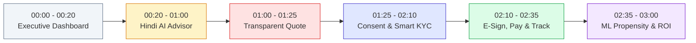

# Final Jury Demo Script: 3-Minute Walkthrough (≤ 180 Seconds)

> [!IMPORTANT]
> **Airtel SYNC 2026 Hackathon · Digital Track A (Project Udyam Digital)**  
> Timed, step-by-step clickable demonstration path designed for a 3-minute jury presentation.  
> Every click exercises a live, running application route, local MongoDB state, and deterministic rules engine.  
> Conforming strictly to **Section 54** and **Section 55** of the Master Engineering Specification.

---

## 1. Pre-Demo Setup & Environment Reset (30 Seconds Before Demo)

Run the fast-reset seed command to establish fresh, reproducible database state:

```bash
cd udyam-one/backend
# Start server if not running
npx nodemon server

# In another terminal:
npm run seed:verify --workspace=backend
```

### Demo URLs & Staff Logins:
- **Client Web Application:** `http://localhost:5173`
- **Owner Demo Login:** `http://localhost:5173/login` (Phone: `9876543210` · Simulated OTP: `123456` or check dev outbox)
- **Admin / Advisor Login:** `http://localhost:5173/login` (Switch to Staff Tab: `admin@airtel.com` or `advisor@airtel.com` · Password: `DemoPassword123!`)
- **Partner Field Desk:** `http://localhost:5173/partner` (Staff Login: `partner@airtel.com` · Password: `DemoPassword123!`)

---

## 2. Timed 180-Second Walkthrough Script



### Stage 1: The Executive Challenge & Funnel Reality Check (00:00 – 00:20 | 20s)
1. **Screen:** Open `http://localhost:5173/backoffice` (or `/admin`).
2. **Action:** Highlight the **Executive Funnel Header**:
   - Total Leads: **5,000 quarterly leads**.
   - Activated Accounts: **368** (**7.36% overall conversion**).
   - Point out the **Four Structural Leaks**:
     - *Leak 1 (Pre-Assessment):* 3,026 drop-outs (65.3% of all losses).
     - *Leak 2 (Quote Friction):* 1,113 drop-outs.
     - *Leak 3 (Paperwork Drag):* 273 drop-outs.
     - *Leak 4 (Post-KYC Installation Delay):* 220 drop-outs.
3. **Talking Point:** *"Good morning leaders. In Airtel's historical SMB funnel, over 92% of prospective enterprises drop out before activating, inflating blended CAC to ₹15,053. Today, we show you Udyam One—a digital platform engineered from first principles to plug each of these four leaks."*

---

### Stage 2: Multilingual Conversational AI Advisor (00:20 – 01:00 | 40s)
1. **Screen:** Click **"Customer View"** or open `http://localhost:5173/advisor`.
2. **Action:**
   - Select **Hindi (हिन्दी)** language toggle.
   - Enter business context in Hindi: *"हमारे पास दिल्ली में 14 कर्मचारियों का लॉ ऑफिस है, हाई-स्पीड इंटरनेट और क्लाउड बैकअप चाहिए।"*
   - Show the Advisor responding empathetically in native Hindi, asking follow-up questions (employee count, budget band).
   - Emphasize that within **$\le 6$ turns**, the advisor generates tailored options.
3. **Talking Point:** *"Notice the conversation is warm and completely in Hindi, yet all pricing numbers are dynamically substituted via placeholders. The LLM never calculates a price—our deterministic rules engine owns every rupee."*

---

### Stage 3: Transparent Quote Builder & Business Preview (01:00 – 01:25 | 25s)
1. **Screen:** Click **"योजना देखें (View Quotes)"** $\implies$ navigates to `http://localhost:5173/quotes`.
2. **Action:**
   - Present the **Standard SMB Bundle**: **₹4,634 / month**.
   - Toggle an add-on (e.g. *Airtel Secure Cyber Guard* or *Static IP*).
   - Show the price updating instantly server-side without price drift.
   - Drag the **Business Preview Slider**: simulate 15 concurrent video conference streams and show why 100 Mbps symmetric leased connectivity is required.
3. **Talking Point:** *"Leak 2 is eliminated by radical transparency: one monthly total, zero hidden hardware fees, zero price drift, and an interactive business preview that lets the owner simulate peak digital hours."*

---

### Stage 4: DPDP Consent & Smart Paperless KYC (01:25 – 02:10 | 45s)
1. **Screen:** Click **"Accept Quote & Proceed to KYC"** $\implies$ `http://localhost:5173/kyc`.
2. **Action:**
   - **Notice v1.0 & Consent:** Point out explicit pre-collection consent modal. Note that unconsented uploads are cryptographically blocked by an HTTP 403 gate. Click **"I Agree (सहमति दें)"**.
   - **Specimen Upload:** Upload specimen documents (e.g. `K03` clean specimen, or `K04` blurred specimen).
   - **Radical Honesty Demo:** 
     - If uploading `K04`: Show the Laplacian blur detection immediately catching the blur (variance `1.25 < 50`) and honestly routing the case to the **Human Review Queue** (`in_review`).
     - Point out: *"We make zero deceptive 'Instant KYC' marketing claims. Clean cases auto-verify; uncertain ones route to our officer review desk."*
   - Briefly switch to `http://localhost:5173/backoffice/kyc-queue` to show the flagged case appearing with extracted vs registry values side-by-side.

---

### Stage 5: Simulated Checkout & Optical Delivery Tracker (02:10 – 02:35 | 25s)
1. **Screen:** Navigate to `http://localhost:5173/checkout/:id` $\implies$ then `http://localhost:5173/tracker`.
2. **Action:**
   - **Simulated E-Sign & Checkout:** Type authorized signatory name, select payment instrument.
   - **Jury Probe Simulator:** Check "Simulate Drop Reason #28 (First payment failed)" to show the instant retry recovery flow saving the sale.
   - **Tracker Stepper:** Navigate to `/tracker`. Show the 5-stage optical delivery stepper:
     - 1. Feasibility Checked
     - 2. Optical Fiber Trenched
     - 3. Optical Light Level Verified (`-19.4 dBm`)
     - 4. CPE Modem Provisioned
     - 5. Active & Handover
   - Select an interactive **2-Hour Technician Window** (e.g. *Morning 09:00 - 11:00*).
3. **Talking Point:** *"Leak 4—our largest post-KYC drop—is eliminated because the customer has real-time visibility into optical trenching and self-schedules their installation slot without calling support."*

---

### Stage 6: ML Propensity Prioritization & Commercial ROI (02:35 – 03:00 | 25s)
1. **Screen:** Switch to `http://localhost:5173/backoffice` (Unclosed Leads Tab).
2. **Action:**
   - Show the unclosed leads queue prioritized by the **L2-regularized logistic regression model** (ROC AUC **0.6879**).
   - Point out transparent feature badges: `+ High Turnover Band`, `+ Multi-Site Architecture`, `- Low Stated Budget`.
   - Conclude with the **₹15.2M ARR Model**: recovering just 382 unclosed leads @ ₹3,318/mo yields ₹15.2M incremental annualized ARR.
3. **Talking Point:** *"Instead of unranked cold lists, our field sales force uses transparent ML propensity scoring to target the highest-yield SMBs, unlocking over ₹15.2 million in high-margin incremental enterprise ARR."*

---

## 3. Demo Fallback & Edge-Case Branching Sheet

| Potential Live Demo Glitch | Rapid Fallback Strategy | Exact User Action |
| :--- | :--- | :--- |
| **External LLM Service Slow / Offline** | System is configured with `MockProvider` by default | Zero disruption; uses deterministic bilingual dialogue tree (`advisor.test.js`) |
| **OCR Timeout on Large Image** | Client provides fallback text cards | Click "Use Specimen Data" to populate pre-verified tokens |
| **Applicant has Cancelled GSTIN** | Expected behavior for `K01` (`37IHKXV5167L1ZS`) | Showcase statutory hard blocker: GSTIN Active check (C05) halts activation |
| **Accidental Server Process Termination** | Quick restart via nodemon | In `udyam-one/backend`, run `npx nodemon server` (restarts in < 2s) |
| **Network Disconnect** | Offline page active | Offline banner renders rules-engine cached catalogue with zero price corruption |
