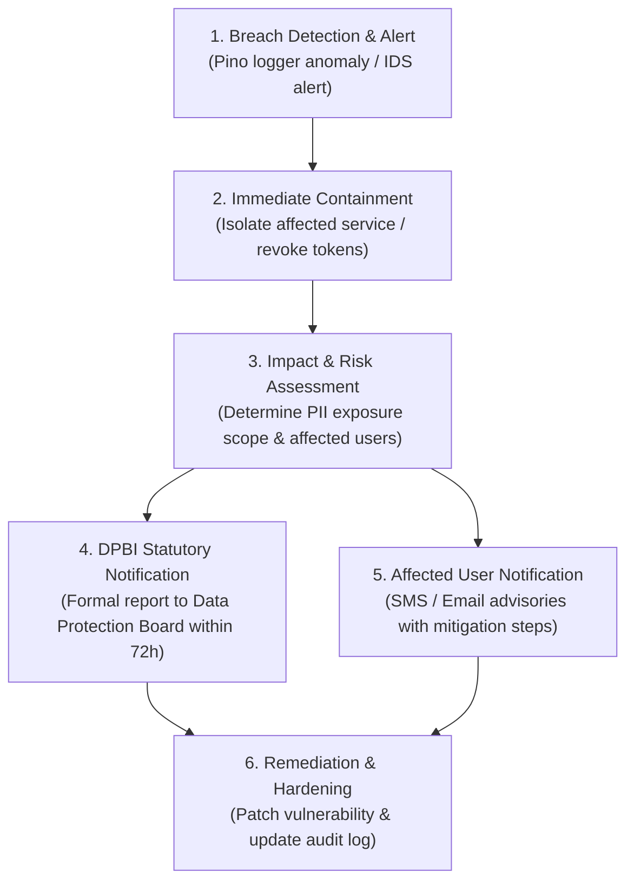

# Data Retention Policy & Incident Response Readiness

> [!NOTE]
> Project Udyam Digital · Udyam One (Airtel SYNC 2026 Track A)
> Technical specifications for statutory data retention schedules, automated cryptographic shredding, and DPDP Act 2023 breach notification readiness.

---

## 1. Statutory Data Retention Schedules

In accordance with the **Digital Personal Data Protection Act, 2023 (DPDP Act)** and Department of Telecommunications (DoT) Unified License conditions, data retention is strictly limited to demonstrable business necessity and statutory compliance:

| Data Category | Retention Period | Regulatory Basis | Post-Retention Action |
| :--- | :--- | :--- | :--- |
| **Unclosed Leads & Inquiries** | 30 Days (Assumption 7) | Purpose fulfilled; non-converting inquiry | Automated database purge; lead records deleted |
| **Rejected KYC Document Vault** | 30 Days | DPDP Section 8(7); dispute and appeal window | Cryptographic key destruction (crypto-shredding) |
| **Active Customer Application Form (CAF)** | Duration of Subscription + 2 Years | DoT Unified License Guidelines | Regulatory audit archival then permanent purge |
| **Call Detail Records (CDR) & Optical Telemetry** | 2 Years Mandatory | Section 5(1), DoT Security Guidelines | Hard purge following statutory inspection period |
| **Financial Invoices & Tax Ledger** | 8 Years | Section 128, Companies Act & GST Act 2017 | Cold statutory financial archive |
| **OTP Challenges & Auth Nonces** | 5 Minutes | Ephemeral authentication security | Automated MongoDB TTL index deletion |
| **Audit Logs (Access, Consent, Erasure)** | 3 Years | DPDP Act Section 8 accountability requirements | Immutable append-only audit trail |

---

## 2. Automated Cryptographic Erasure (Crypto-Shredding)

When a Data Principal exercises their **Right to Erasure** (`POST /api/v1/me/deletion-requests`) or an unclosed lead reaches the 30-day retention ceiling:

1. **Storage Decoupling:** Document files encrypted with `AES-256-GCM` have their unique initialization vectors and per-record key references purged. Without the cryptographic key material, existing ciphertext becomes mathematically unrecoverable ($2^{256}$ keyspace).
2. **PII Scrubbing:** Signatory mobile hashes, contact names, and email addresses in `Lead` and `User` records are overwritten with anonymized placeholders (`[ERASED_USER_DATA]`).
3. **Audit Trail Preservation:** A tamper-resistant audit entry is recorded in `AuditLog`:
   ```json
   {
     "actorId": "USER_ID",
     "role": "owner",
     "action": "DATA_DELETION_REQUESTED",
     "entityType": "DeletionRequest",
     "entityId": "REQ_ID",
     "timestamp": "2026-11-04T17:30:00Z"
   }
   ```
4. **Statutory Exemption Flagging:** Data required for ongoing DoT compliance (e.g. active telecom circuits) cannot be purged prematurely; the response clearly informs the user of the statutory retention date.

---

## 3. Data Breach Response Protocol (DPDP Section 8(6))

Under Section 8(6) of the DPDP Act 2023, the Data Fiduciary must notify the **Data Protection Board of India (DPBI)** and each affected Data Principal in the event of any personal data breach:



### Protocol Steps:
1. **Detection (T+0):** Any unauthorized access attempt, decryption anomaly, or token leakage automatically generates a high-priority alert.
2. **Containment (T+2h):** Affected database sessions are invalidated; active encryption keys are rotated; compromised endpoints are temporarily isolated.
3. **Assessment (T+12h):** Forensic inspection determines whether any unmasked PII or encrypted document ciphertexts were accessed.
4. **Statutory Notification (T+72h):** Written notification delivered to the Data Protection Board of India detailing:
   - Nature and extent of personal data involved.
   - Likely consequences of the breach.
   - Measures adopted to mitigate adverse effects.
   - Contact details of the designated Data Protection Officer (DPO).
5. **Data Principal Communication:** Impacted users receive clear, plain-language notifications via masked SMS and registered email with actionable advice to safeguard their accounts.
