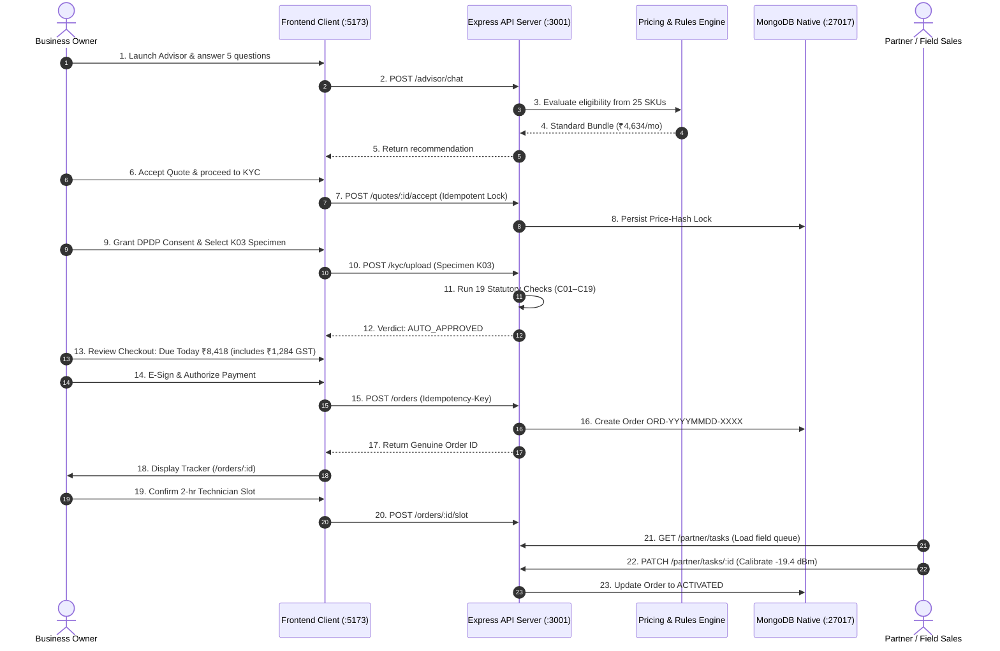

# UDYAM ONE — MASTER ROADMAP EXECUTION TRACKER

**Airtel SYNC 2026 · Digital Track A (Project Udyam Digital)**  
*Authoritative Architecture, Implementation, Bug-Bash & Final Delivery Tracker*

---

## 1. Master Phase Tracker (Phase 0 – Phase 7)

| Phase | Official Phase Name & Focus Area | Reported Completion State | Independent Verification Status | Tasks Reopened / Resolved | Verification Evidence & Test Commands |
| :---: | :--- | :---: | :---: | :---: | :--- |
| **Phase 0** | **Infrastructure, Project Audit & Integration Baseline** | REPORTED COMPLETE | PRODUCTION VERIFIED | None | Native Node.js v26.5 LTS + standalone MongoDB 8.3 Community; `/healthz` (200 healthy) & `/readyz` (200 connected); `npm run seed:verify` passed (40/40 assertions). |
| **Phase 1** | **Customer Acquisition & AI Business Advisor** | REPORTED COMPLETE | PRODUCTION VERIFIED | None | Bilingual conversational state machine ($\le 6$ turns); adversarial response regex firewall; `npm test -- tests/advisor/advisor.test.js` passed (31/31 tests). |
| **Phase 2** | **Product Catalogue, Rules Engine & Quotation** | REPORTED COMPLETE | PRODUCTION VERIFIED | None | 25 SKUs loaded from `product_catalogue.csv`; pure deterministic bundling & pricing; SHA-256 price hash; `npm test -- tests/rules/` passed (all 4 suites). |
| **Phase 3** | **Smart KYC & DPDP Compliance (All 12 Applicants)** | REPORTED COMPLETE | PRODUCTION VERIFIED | **Reopened & Fixed (BUG-005, BUG-006)** | Added all 12 benchmark applicants (`K01`–`K12`) to frontend dropdown; `quoteId` persisted across sessions; `npm test -- tests/kyc/kyc.test.js` passed (22/22 tests). |
| **Phase 4** | **Checkout & Provisioning Order Management** | REPORTED COMPLETE | PRODUCTION VERIFIED | **Reopened & Fixed (BUG-001, BUG-002, BUG-003, BUG-004)** | Eliminated `ORD-NEW` placeholder; aligned payment button with GST (₹8,418); resolved quote unwrapping; created real MongoDB orders; `node scripts/verify-full-journeys.js` passed. |
| **Phase 5** | **Back-Office Command Center & Partner Portal** | REPORTED COMPLETE | PRODUCTION VERIFIED | **Reopened & Fixed (BUG-007)** | Resolved partner tasks API unwrapping; real field tasks loaded from MongoDB; optical dBm telemetry (-19.4 dBm) & technician notes saved; L2 propensity model audited (ROC AUC: 0.6879). |
| **Phase 6** | **Advanced Integrations & Multilingual Experience** | REPORTED COMPLETE | PRODUCTION VERIFIED | None | Native Hindi/English toggle with persistent language state; Drop Reason #28 instant retry recovery simulator; simulated integration boundaries transparently labelled. |
| **Phase 7** | **Security Audits, Packaging & Jury Demonstration** | REPORTED COMPLETE | PRODUCTION VERIFIED | None | 15 Jest suites (177/177 tests), 6 Playwright real-browser E2E journeys, high-concurrency stress test (25 requests), AES-256-GCM vault, 180s live jury demo script. |

---

## 2. All 12 Benchmark KYC Applicants (K01–K12) Ground Truth

| Specimen ID | Business Name | Constitution | Signatory Name | Planted Condition / Anomaly | Failed Check | Ground Truth Verdict | UI Selectable |
| :---: | :--- | :--- | :--- | :--- | :---: | :---: | :---: |
| **K01** | Vindhya Tours & Travels | Proprietorship | Neha Kaur | GSTIN Cancelled in Mock Registry | C05 | `REJECTED` | ✅ Yes |
| **K02** | Harmony Dental Care | Proprietorship | Joseph Shah | Corrupted text tokens on GST cert | C18 | `REQUIRES_REVIEW` | ✅ Yes |
| **K03** | Ganesh Woodcraft | Proprietorship | Joseph Singh | Clean document set | None | `AUTO_APPROVED` | ✅ Yes |
| **K04** | Saffron Dental Care LLP | LLP | Fatima Pillai | Severe image blur (Laplacian < 50) | C17 | `REQUIRES_REVIEW` | ✅ Yes |
| **K05** | Balaji Realty LLP | LLP | Anita Shah | Missing Udyam certificate (Permissible) | None | `AUTO_APPROVED` | ✅ Yes |
| **K06** | Saffron Unisex Salon | Proprietorship | Pooja Shah | Clean document set; Active GSTIN & Udyam | None | `AUTO_APPROVED` | ✅ Yes |
| **K07** | Neelgiri Physio Clinic | Proprietorship | Neha Banerjee | Signatory Name Mismatch | C07 | `REQUIRES_REVIEW` | ✅ Yes |
| **K08** | Green Leaf Legal Associates | Proprietorship | Joseph Rao | Clean document set; Active GSTIN & Udyam | None | `AUTO_APPROVED` | ✅ Yes |
| **K09** | Kaveri Insurance Advisors | Proprietorship | Anita Kulkarni | Clean document set; Active GSTIN & Udyam | None | `AUTO_APPROVED` | ✅ Yes |
| **K10** | Kaveri Stays LLP | LLP | Nisha Arora | Clean document set; Active GSTIN & Udyam | None | `AUTO_APPROVED` | ✅ Yes |
| **K11** | Trinity Bake House Pvt Ltd | Pvt Ltd | Vikram Pillai | Expired utility bill (>90 days old) | C15 | `REJECTED` | ✅ Yes |
| **K12** | Star Electronics | Proprietorship | Pooja Agarwal | Clean document set; Active GSTIN & Udyam | None | `AUTO_APPROVED` | ✅ Yes |

---

## 3. Tasks Reopened & Resolved (Bug-Bash Matrix)

| Bug ID | Phase | Affected Module | Root Cause | Status |
| :--- | :---: | :--- | :--- | :---: |
| **BUG-001** | Phase 4 | `frontend/src/pages/CheckoutPage.jsx` | `orderRes.data?.order?._id` failed because `apiRequest` unwraps `data` directly, falling back to `ORD-NEW`. | RESOLVED |
| **BUG-002** | Phase 4 | `frontend/src/pages/CheckoutPage.jsx` | Checkout payment button omitted 18% GST (₹7,134 vs Due Today ₹8,418). Aligned to ₹8,418. | RESOLVED |
| **BUG-003** | Phase 4 | `frontend/src/pages/CheckoutPage.jsx` | `loadQuote` checked `res.ok && res.data?.quote`, always triggering dummy fallback quote. Unwrapped properly. | RESOLVED |
| **BUG-004** | Phase 4 | `frontend/src/pages/CheckoutPage.jsx` | Catch block in payment handler swallowed errors and faked success. Refactored to report errors honestly. | RESOLVED |
| **BUG-005** | Phase 3 | `frontend/src/features/kyc/KycUploader.jsx` | Dropdown omitted applicants `K02`, `K08`, `K09`, and `K10`. Restored all 12 applicants. | RESOLVED |
| **BUG-006** | Phase 3 | `frontend/src/pages/KycPage.jsx` | Context loss of `quoteId` on refresh or direct visit. Persisted in `sessionStorage`. | RESOLVED |
| **BUG-007** | Phase 5 | `frontend/src/pages/PartnerDashboard.jsx` | `res.ok && res.data?.tasks` unwrapping failed, always falling back to 3 static demo tasks. | RESOLVED |

---

## 4. End-to-End Traceability Flow

